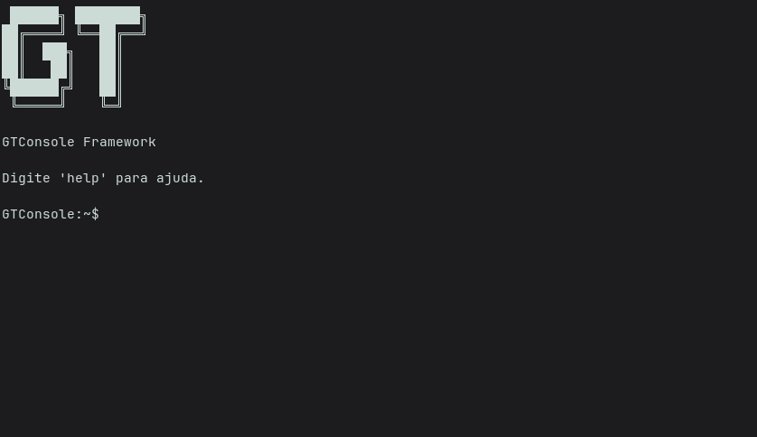

# GTConsole — Console Open Source para Execução de Ferramentas

O **GTConsole** é um console open source, leve e personalizável, desenvolvido para facilitar a execução e o gerenciamento de ferramentas diretamente pelo terminal.

O projeto busca oferecer uma experiência simples, rápida e organizada, permitindo centralizar diferentes ferramentas em uma única interface de console.

---

<div align="center">
  
</div>

---

## 📦 Download e instalação

Baixe a versão desejada do **GTConsole** na página oficial de Releases:

**[GTConsole Releases — Downloads](https://github.com/dyalncerqueira827-dot/GtConsole-framework/releases)**

Após baixar o arquivo, siga as instruções correspondentes ao formato disponibilizado.

### 1. Extração dos arquivos

**GTConsole 1.14 (.tar.xz):**

```bash
tar -xJf GTConsole-*.tar.xz
```

**GTConsole 1.13 ou versões distribuídas em `.tar.gz`:**

```bash
tar -xzf GTConsole-*.tar.gz
```

### 2. Entre no diretório do projeto

```bash
cd GTConsole-*
```

### 3. Dê permissão de execução ao arquivo

```bash
chmod +x GTconsole.py
```

### 4. Execute o GTConsole

```bash
python3 GTconsole.py
```

---

### ⚡ Instalação rápida

Para versões distribuídas em `.tar.gz`, você pode executar todas as etapas de uma só vez:

```bash
tar -xzf GTConsole-*.tar.gz && cd GTConsole-* && chmod +x GTconsole.py && python3 GTconsole.py
```

**Requisitos:** Python 3 e um terminal compatível com a execução de aplicações Python.
